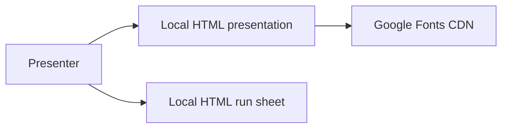

<!-- Auto-generated by the documentation-automation workflow on 2026-10-19. -->

# Architecture

## Overview

This repository is a content-only deliverable, not a deployed application. Its main artifact is a self-contained HTML presentation containing its imagery, video, scripts, and styles; the second artifact is an HTML speaker run sheet. There is no backend, API, build configuration, or deployment configuration in the repository (`README.md:7-12`).

## Components and flow

- **Presentation deck** — the Design + Innovation revised-plan presentation; embedded media and code allow it to run as a local HTML file (`README.md:9-12`).
- **Run sheet** — slide-by-slide speaking notes, cues, and timings for the presentation (`LJC-Design-Innovation_Revised-Plan_Run-sheet_DRAFT.html:1-33`).
- **Browser** — renders both files locally. The deck uses keyboard, click, and slide-index navigation as described in the repository instructions (`README.md:14-22`).
- **Fonts** — the deck requests fonts from Google Fonts; system-font fallback is documented for offline use (`LJC-Design-Innovation_Revised-Plan_DRAFT.html:8-10`, `README.md:22`).

## Technology and design

The deliverables use HTML, CSS, and embedded JavaScript. Images, the sample video, and animation libraries are embedded in the deck rather than served by an application backend (`README.md:9-12`; `LJC-Design-Innovation_Revised-Plan_DRAFT.html:1282-1283`). No application runtime, data store, or deployment architecture is present.

## Resolved configuration

No workflows or `vars.NAME` references are present in the repository. The authoritative dispatch-time configuration result supplied with the issue contains no usable variable rows (it returned a 404); therefore no values or tiers can be resolved, and repository files are not used as substitutes.
