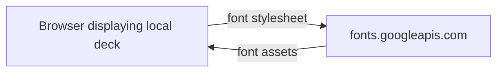

<!-- Auto-generated by the documentation-automation workflow on 2026-10-19. -->

# Integrations

This repository contains no application API, database, storage, messaging, identity-provider, or internal-service integration. The only external runtime connection evidenced by the files is Google Fonts. The design-tool credits are not runtime connections.

| Dependency | Type | Direction | Auth method | Credential location | Environments |
|---|---|---|---|---|---|
| Google Fonts (`fonts.googleapis.com`, `fonts.gstatic.com`) | Font CDN | Outbound, browser → CDN | No authentication configured | None | Local browser use |

## Google Fonts

The presentation requests its stylesheet from `fonts.googleapis.com` and preconnects to `fonts.gstatic.com` (`LJC-Design-Innovation_Revised-Plan_DRAFT.html:8-10`). The README says the documents work offline with system-font fallback (`README.md:22`). No credential, endpoint API, or app-side data is involved. The request is made by the user's browser over the public internet; the repository contains no private-network path, firewall, or allowlist configuration.

## Other listed tools

GSAP and Osmo Vault appear in the credits as animation and design-resource attributions, not as runtime endpoints (`README.md:32-36`). GSAP code is embedded in the presentation; the source does not show a CDN request for it. No credentials are documented for these attributions.

## Resolved configuration

No workflows or `vars.NAME` references are present. The authoritative dispatch-time configuration result supplied with the issue contains no usable variable rows (it returned a 404); no external endpoint, Key Vault, or other variable value is inferred from repository files.
